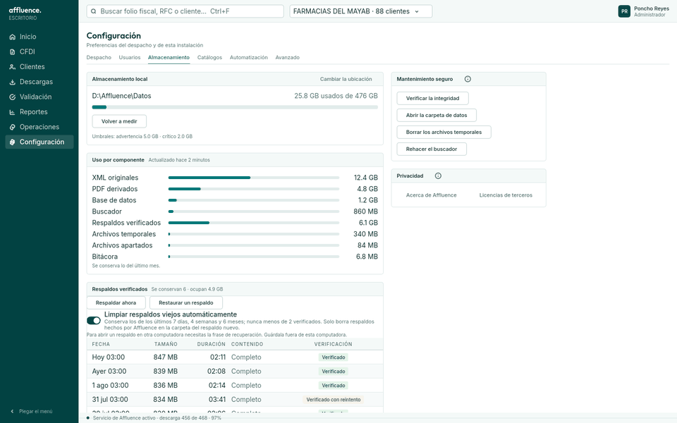
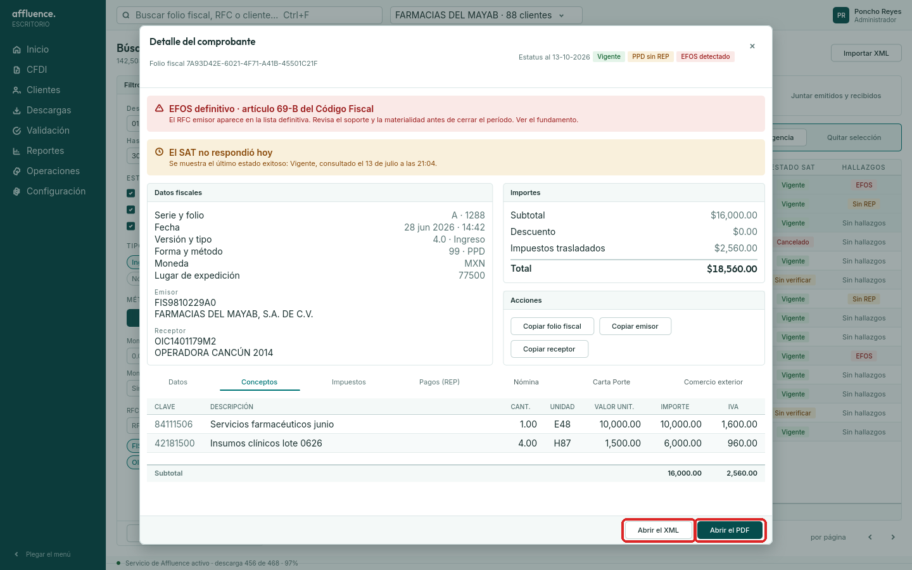

# Dónde están mis archivos

Affluence guarda todo en su **carpeta de datos**, dentro de tu usuario de Windows:

```
%LOCALAPPDATA%\Affluence
```

(equivale a `C:\Users\<tu usuario>\AppData\Local\Affluence`). Si cambiaste la ubicación en
Configuración → Almacenamiento → **Cambiar la ubicación**, la carpeta es la que elegiste; la ves
escrita en esa misma pantalla.

## Qué hay en cada carpeta

| Qué | Carpeta | Cómo se acomoda |
|---|---|---|
| **XML de los CFDI** | `xml\cfdi` | Por año y mes de emisión: `xml\cfdi\2025\03\<folio fiscal>.xml`. Son los archivos tal cual los entrega el SAT |
| **PDF** | `pdf` | Un archivo por comprobante, nombrado con su folio fiscal |
| **Reportes en Excel** | `reportes` | `RFC_desde_hasta_....xlsx`; lo exportado desde la búsqueda empieza con `busqueda_` |
| **Expedientes (ZIP)** | `expedientes` | `Expediente_RFC_desde_hasta_....zip` |
| **XML exportados** | `exportados` | Copias que sacaste desde el detalle de un comprobante |
| Paquetes del SAT | `descargas` | Uso interno |

Los XML **no están separados por cliente**: todos van por año y mes. Para entregar los de un cliente
ordenados, usa el **expediente** (Operaciones), que los junta en un ZIP del periodo.

## Atajos desde el Explorador de Windows

Pega cualquiera en la barra de direcciones del Explorador (**Win + E**, luego clic en la barra) y
presiona Enter:

```
%LOCALAPPDATA%\Affluence\xml\cfdi
%LOCALAPPDATA%\Affluence\pdf
%LOCALAPPDATA%\Affluence\reportes
%LOCALAPPDATA%\Affluence\expedientes
```

También sirve **Win + R**, pegar la ruta y Enter.

## Abrirlas desde la aplicación

**Carpeta de datos completa:** Configuración → pestaña **Almacenamiento** → **Abrir la carpeta de
datos**. Ahí entras a `xml\cfdi`, `pdf`, `reportes` o `expedientes`.



**Un comprobante:** en **CFDI**, abre el detalle del comprobante y usa **Abrir el XML** o **Abrir el
PDF**.



**Reportes, PDF masivo y expedientes:** al terminar de generarlos aparece el botón **Abrir la
carpeta**.

## Lo que no conviene hacer

- **No muevas, renombres ni borres** archivos dentro de la carpeta de datos. Affluence los busca
  exactamente ahí; si falta uno, su detalle o su PDF fallan. Para cambiar de disco usa **Cambiar la
  ubicación**.
- Para llevarte copias, **cópialas** a otra carpeta en lugar de moverlas.
